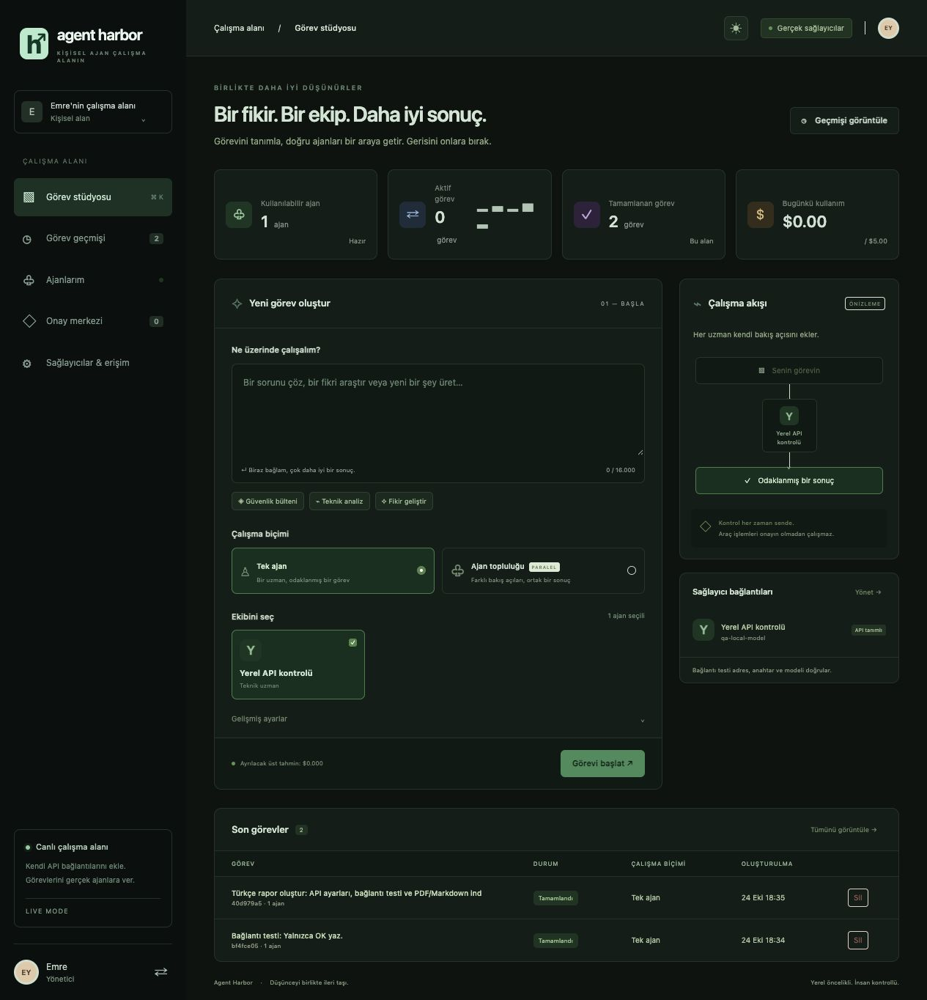
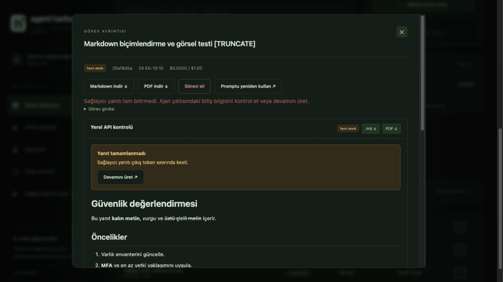
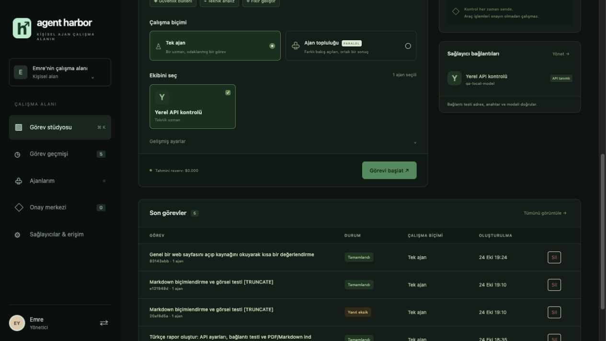
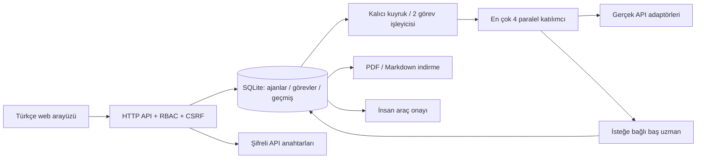

# ECY Agent Harbor

Kendi AI ajanlarını API adresleri ve anahtarlarıyla yönetebileceğin, tek ajan veya paralel uzman topluluğu çalıştırabileceğin kişisel web uygulaması. **Normal açılış gerçek sağlayıcı modudur.** Uygulama anahtarlarını istemez, kendi başına mevcut makinelerine bağlanmaz; bağlantıları sen ayarlardan eklersin.

## Özellikler

- Tek ajan görevi veya paralel ajan topluluğu ve seçilebilir baş uzman sentezi.
- API adresi ve anahtarıyla sağlayıcı yönetimi; yerel inference ve OpenAI uyumlu servisler.
- Görev bazında açılıp kapatılan internet erişimi ve Playwright MCP kurulumu.
- Markdown yanıtlar, PDF/Markdown indirme, görev geçmişi ve yürütme kayıtları.
- Rol bazlı erişim, araç onayı, şifrelenmiş anahtar saklama ve USD kullanım takibi.
- Açık/karanlık tema ve mobil uyumlu arayüz.

## Ekran görüntüleri

Aşağıdaki görüntüler geliştirme sırasında test verileriyle alınmıştır. Bazı görseller önceki arayüz sürümünü gösterir; güncel sürümde harcama limiti yoktur ve uygulama adı ECY Agent Harbor'dır.

### Görev stüdyosu — karanlık tema



### Markdown raporları



### İnternet araştırması



## Çalıştırma

Mac'te **Baslat.command** dosyasına çift tıkla. Gerekli Python bileşenleri eksikse proje içinde `.venv` oluşturur ve `requirements.txt` dosyasından kurar. Python 3.9 veya üzeri gerekir.

Terminalden aynı klasörde:

```sh
./Baslat.command
```

Bileşenler zaten kuruluysa doğrudan:

```sh
python3 run.py
```

Tarayıcıda **http://localhost:8080** adresini aç. İlk açılışta en az 12 karakterli kendi yönetici parolanı belirle. Sonraki açılışlarda aynı parolayla giriş yap. Uygulamayı durdurmak için çalıştığı terminalde Ctrl+C.

Alternatif modül komutu `python3 -m app.server` şeklindedir; `-m app/server.py` yazılmaz. `run.py` mutlak dosya yoluyla da açılabilir ve çalışma klasörüne bağlı değildir.

Docker ile:

```sh
docker compose up --build
```

Port yalnızca 127.0.0.1 üzerinde yayınlanır. İlk kurulum yine `localhost:8080` üzerinden yapılır. Container içindeki veriler `harbor-data` volume içinde kalır. `docker compose down` veriyi korur. Docker servisinin açık olması gerekir.

## Kendi ajanını ekle

1. **Sağlayıcılar & erişim → Yeni ajan ekle** ekranını aç.
2. Ajan adı, uzmanlık, model kimliği ve API türünü seç.
3. API adresini gir. OpenAI uyumlu API için servisinin base URL adresini kullan; sürüm yolu varsa dahil et. `/chat/completions` uygulama tarafından eklenir.
4. API anahtarını gir. Anahtarsız yerel inference sunucularında boş bırakılabilir.
5. Modelin toplam giriş/çıkış tokenları için kendi USD / 1.000 token fiyatını tanımla. Yerel sunucuda 0 seçebilirsin.
6. **Ajanı kaydet**, ardından **Bağlantıyı test et** düğmesini kullan. Test, en çok 32 çıktı tokenı isteyen gerçek bir model çağrısı yapar. Sağlayıcın bu çağrıyı ücretlendirebilir; kullanım bütçe ve görev geçmişine kaydedilir.
7. Stüdyo varsayılan olarak tek ajan modunda açılır ve kullanılabilir ilk ajanı seçer. İstersen Ajan topluluğu moduna geç. Ajanı stüdyoda seçip görevi başlat. Birden fazla ajan seçersen paralel çalışırlar. Baş uzman seçersen çıktılar ardından ona aktarılır ve sentez üretilir.

Yeni ajanların sayısı sabit değildir; görev başına en çok dört katılımcı ve isteğe bağlı bir baş uzman seçilebilir. Aynı ajan iki rolü üstlenirse iki ayrı çağrı yapılır. Baş uzman olmadan bağımsız çıktılar da alınabilir.

Ajanı düzenlerken API anahtarı alanını boş bırakırsan eski anahtar korunur. Yeni bir anahtar yazarsan değiştirilir; **Kayıtlı API anahtarını kaldır** ile silinir. Anahtarın mevcut değeri hiçbir API yanıtında gösterilmez. **Pasife al / Etkinleştir** düğmesi (ve düzenleme formundaki **Bu ajanı görevlerde kullan** seçeneği) ajanı doğrudan açıp kapatır. **Sil** düğmesi onay sonrası ajanı listeden ve kayıtlı API anahtarını depodan kaldırır; eski raporlarda ajan adı ve çıktılar korunur. Kuyrukta veya çalışmakta olan görevi varsa ayar değişikliği görev bitene kadar reddedilir.

## Görev geçmişini silme

Görev satırındaki **Sil**, ayrıntıdaki **Görevi sil**, seçim kutuları ile **Seçilenleri sil** veya **Geçmişi temizle** kullanılabilir. Her silme önce onay ister. Tamamlanan, başarısız ve iptal edilmiş işler silinebilir. Çalışan, kuyruktaki, sağlayıcı çağrısı hâlâ bitmemiş ve araç onayı bekleyen görevler korunur. Yönetici tüm geçmişi, operatör sadece kendine ait işleri silebilir; gözlemci silemez.

Görev, ajan çıktıları, loglar, onay kayıtları ve o görev için sunucuda yazılmış dosya kalıcı silinir. Geçmiş silinse de harcama toplamını doğru tutmak için yalnızca tarih ve tutar içeren içeriksiz bir kullanım kaydı korunur. Tarayıcıya daha önce indirilmiş dosyalar etkilenmez. Toplu temizleme yalnızca ekranda gösterilen son 100 kayıtla sınırlı değildir.

## Tema ve giriş sınırı

Üst çubuktaki güneş/ay düğmesi açık ve karanlık temalar arasında geçiş yapar. Tercih tarayıcıda saklanır; ilk açılışta sistem tercihi izlenir. Varsayılan çalışma biçimi tek ajandır. Bağlam giriş sınırı hem arayüzde hem sunucuda **16.000 karakterdir**; Türkçe/Unicode karakterler için istek gövdesi sınırı uyarlanmıştır.

## PDF ve Markdown indirme

Görev ayrıntısında:

- **Markdown indir:** görev girdisi, durum, maliyet, varsa baş uzman sentezi ve ajan çıktılarını `.md` olarak indirir.
- **PDF indir:** aynı raporu Türkçe karakterleri destekleyen sayfa düzeniyle PDF olarak indirir.
- Her ajan çıktısının yanındaki **.md / PDF** düğmeleri yalnızca o ajanın çıktısını ve görev bağlamını indirir.

İndirmeler oturum gerektirir. Sağlayıcı çıktısındaki HTML çalıştırılmaz. PDF temel Markdown başlıklarını ve kalın metni düzenler; karmaşık tablolar, LaTeX veya gömülü görseller için tam bir Markdown yayın motoru değildir. Yazı tipinde olmayan karakterler kaybolmak yerine `[U+....]` biçiminde gösterilir. Tarayıcının indirme dosyaları kendi indirme klasörüne gider; sunucuya dosya kaydetme ayrı, yönetici onayı isteyen araç işlemidir.

## Erişim ve anahtar saklama

| Rol | Yetki |
|---|---|
| Yönetici | Ajan/API ayarları, bağlantı testi, rol parolaları, tüm görevler, iptal, araç onayı |
| Operatör | Görev oluşturma, ortak görevleri okuma, kendi görevini iptal etme |
| Gözlemci | Görev, çıktı ve logları okuma |

Operatör ve gözlemci parolaları yönetici tarafından ayarlardaki **Erişim parolaları** bölümünden belirlenir. Parola değişince o rolün açık oturumları kapanır. Bu sürümde her rol bir hesaba karşılık gelir; kişi bazlı çok kullanıcılı SSO değildir. Tüm roller aynı çalışma alanının görevlerini okuyabilir.

- Parolalar rastgele salt ve 600.000 turluk PBKDF2-SHA256 ile hashlenir.
- API anahtarları Fernet ile şifrelenerek SQLite'ta saklanır. Yerel şifreleme anahtarı `data/master.key` dosyasında 0600 izinle oluşturulur.
- Veritabanı 0600 izinlidir. Anahtarlar sunucu loglarına veya tarayıcıya geri yazılmaz.
- Oturumlar 8 saatlik HttpOnly + SameSite=Strict çerezleridir. Yazma isteklerinde CSRF ve origin kontrolü vardır. Giriş denemeleri sınırlandırılır.

**Yedekleme:** `harbor.db` dosyasıyla birlikte `master.key` dosyasını da koru; anahtar olmadan kayıtlı API anahtarları açılamaz. Master key ve veritabanının aynı makinede bulunması, tüm makineye erişen bir kişiye karşı koruma sağlamaz. Disk/yedek erişimi işletim sistemi ve dağıtım katmanının sorumluluğundadır. Görev metinleri veritabanında şifrelenmez. `data/` ve `.env` kaynak arşivinden dışlanır.

## Bağlantı türleri

**OpenAI uyumlu API:** Sunucunun `POST <base>/chat/completions` sözleşmesini desteklemesi gerekir. Kendi yerel inference düğümünü veya bu sözleşmeyi sunan model sağlayıcını bağlayabilirsin. Uygulama model yüklemez; model kimliğini senin çalışan sunucundaki haliyle yazmalısın. OpenAI uyumlu olmayan native API'ler için ayrı adaptör gerekir.

**Hermes güvenli bridge:** Mevcut Hermes kurulumunun bir HTTP API'si olduğu varsayılmaz. Hermes profilini kullanmak için [PROVIDERS.md](docs/PROVIDERS.md) içindeki `/v1/tasks` sözleşmesini uygulayan, araçları kendi tarafında kapatan bir bridge gerekir. Bu uygulama mevcut Hermes kurulumunu değiştirmez veya bridge servisini otomatik kurmaz. Hermes'inin zaten OpenAI uyumlu bir API'si varsa o API türünü seçebilirsin.

M4 Mac mini / MiniMax M3, Ryzen 5600X / RTX 3060 Ti / 64 GB profilleri düzenlenebilir başlangıç kayıtlarıdır; API adresi eklenmedikçe bağlı sayılmazlar. Raspberry Pi / Cloudflare Tunnel ve mevcut Telegram otomasyonu değiştirilmez.

## Çalışma mimarisi



Kaynaklar: `app/server.py` (API, erişim, ajan ayarları, kuyruk), `app/adapters.py` (sağlayıcılar), `app/vault.py` (API anahtarları), `app/exports.py` (raporlar), `static/` (arayüz). Detaylar: [API.md](docs/API.md), [ARCHITECTURE.md](docs/ARCHITECTURE.md), [PROVIDERS.md](docs/PROVIDERS.md).

## Limitler ve işletim

Harcama sınırı uygulanmaz. Uygulama bugünkü ve toplam kullanım tutarını kaydeder; günlük kota veya görev bütçesi nedeniyle işi engellemez. Eski `DAILY_BUDGET_USD` ve istek gövdesindeki `budget` değerleri artık uygulanmaz. API uyumluluğu için `daily_limit` alanı `null`, eski veritabanı budget/reserved alanları yeni görevlerde 0 tutulur. Fiyatlar sağlayıcının gerçek faturası yerine geçmez; kendi USD / 1.000 token tarifenle ayarlamalısın.

Açık görev kuyruğu 50 ve işleyici sayısı 2 gibi çalışma kaynakları ayarları harcama kotası değildir. Normal görevlerde sağlayıcıya `max_tokens`/`max_output_tokens` gönderilmez; çıktı boyutu veya saklama karakter sınırı konmaz. Gerçek sağlayıcı kullanım miktarı raporlanır; sağlayıcının model/bağlam sınırları geçerlidir.

Görev iptali başlamış sağlayıcı isteğini geri alamaz; o isteğin maliyeti yine kaydedilir. Yeniden başlatmada yarıda kalan görevler başarısız işaretlenir ve çift çağrı riskini azaltmak için otomatik tekrarlanmaz. Kuyruktakiler ve bekleyen onaylar korunur. UI son 100 görevi gösterir; eski kayıtlar veritabanında kalır.

Kişisel kullanım için tek instance çalıştır. Python HTTP sunucusunu doğrudan internete açmak üretim dağıtımı değildir. Uzaktan erişim için ayrıca HTTPS reverse proxy, `PUBLIC_ORIGIN`, `COOKIE_SECURE=1`, uygun ağ erişimi ve işletim kontrolleri gerekir. Container `localhost` adresi container'ın kendisidir; Mac host servisleri için uygun olduğunda `host.docker.internal`, başka düğümler için gerçek özel ağ adresini kullan.

Normal uygulama açılışı `live` moddur. Testler gerçek sağlayıcıları çağırmadan geçici yerel sahte servisler ve mock adapter kullanır; arayüzde demo modu seçimi yoktur. Ortamdan verilen eski sağlayıcı ayarları ilk veritabanı oluşturulurken başlangıç profillerine alınır; sonraki değişiklikler ayarlardan yönetilir. Doğrudan Python çalıştırma `.env` dosyasını otomatik yüklemez. `AUTH_*_TOKEN` değişkenleri ileri düzey eski rol erişimiyle uyumluluk için korunur; normal kullanımda gerekmez.

## Testler

```sh
python3 -m unittest discover -s tests -v
node --check static/app.js
node --check static/settings.js
docker compose config --quiet
```

İlk kurulum, giriş, anahtar şifreleme ve redaksiyon, kalıcı ayarlar, yetki sınırları, gerçek HTTP sözleşmesi, bağlantı testi, görev/judge, kuyruk, iptal ve rapor indirmeleri test edilir. Kontrol sonuçları [VERIFICATION.md](docs/VERIFICATION.md) içindedir.

## Markdown ve sağlayıcının kesmesi

Görev ekranı Markdown başlıklarını, listeleri, kalın/italik/üstü çizili metni, tabloları, kod bloklarını, alıntıları, bağlantıları ve görselleri işler. Marked ve DOMPurify projeye yerel olarak eklenmiştir; çalışma sırasında CDN betiği yüklenmez. HTML, event handler ve tehlikeli bağlantılar temizlenir. Görseller desteklenir; PDF motoru önceki temel metin düzenini kullanır, web Markdown görünümünü birebir kopyalamaz.

Sağlayıcı `finish_reason=length` veya benzeri eksik bitiş bildirirse hem run hem görev `incomplete` olur; araç çalıştırılmaz ve eksik katılımcılarla judge sentezi yapılmaz. **Devamını üret** özgün görevi ve önceki çıktının tamamını kullanarak ayrı bir tek ajan görevi açar. Hiçbir uygulama çıkış token sınırı konmaz; sağlayıcının/modelin kendi üretim ve bağlam sınırları hâlâ geçerlidir.

Eski sürümde 1.500 tokena ulaşmış ve bitiş bilgisi kaydedilmemiş yanıtlar başlangıçta "eski sınır nedeniyle eksik olabilir" olarak işaretlenir; metinler değiştirilmez. Bağlantı testi normal görev değildir ve küçük bir sağlık çağrısı için 32 token ister.

## İnternet anahtarı ve Playwright MCP

Ayarlar sayfasındaki **İnternet erişimi · Playwright MCP** bölümü Node.js durumunu ve kurulumu gösterir. **Playwright MCP kur** düğmesi sabit sürüm `@playwright/mcp@0.0.83` paketini yalnızca `data/browser-runtime` içine kurar. Mac'te mevcut Chrome varsa bunu **ayrı, geçici ve oturumsuz bir profilde** kullanır; kişisel tarayıcı profiline bağlanmaz. Chrome yoksa Chromium indirir. Node.js 18+ ve npm gerekir; Dockerfile bunları ve Chromium'u içerir.

Görev girişindeki **İnternet kapalı / açık** düğmesi yalnızca o görev için web araçlarını açar. Varsayılan kapalıdır ve sayfa yenilenince kapalı başlar. Açıkken `web_search` ve `web_open` adlı iki function tool modele verilir. Araç sonucu MCP üzerinden tekrar modele iletilir; tüm model çağrılarının token kullanım ve maliyetleri birleştirilir. Bir görevde varsayılan 12 web aracı adımı vardır (`WEB_MAX_TOOL_STEPS`); bu, model yanıtının uzunluk sınırı değildir. Araç adımları dolarsa model mevcut kaynaklarla son yanıtını verir.

Bu entegrasyon **OpenAI uyumlu function calling destekleyen modelleri** gerektirir. Hermes bridge sözleşmesi bu araç döngüsünü uygulamadığından internet açık Hermes görevi açık bir hatayla reddedilir; sessizce internetsiz çalıştırılmaz.

Yalnızca genel HTTP/HTTPS sayfaları, 80/443 portları ve GET/HEAD istekleri desteklenir. Ağ geçidi DNS sonucunu kontrol edip doğrulanmış genel IP'ye bağlanır; yerel/özel IP ve metadata adresleri engellenir. Playwright context guard POST/diğer yöntemleri ve WebSocket'leri kapatır. Tıklama, form doldurma, yükleme, JavaScript çalıştırma, shell veya dosya okuma araçları modele verilmez. Profil ve MCP çıktıları görev sonunda temizlenir; logda yalnızca ziyaret edilen alan adı tutulur. CAPTCHA, oturum isteyen veya otomatik taramayı engelleyen sitelere erişim garanti edilmez.

Modelin arama sorguları Google'a, ziyaret adresleri ilgili web sitelerine gider. Özel log parçaları ve anahtarlar sorgulara eklenmemelidir. Web sayfaları güvenilmeyen veri olarak modele sunulur. Bu tarayıcı metin okuma aracıdır; genel amaçlı tarayıcıda işlem yapma yetkisi değildir.

## Sağlayıcı özeti

Üst çubuk son bağlantı testleri ve görev sonuçlarına göre **çalışıyor / çalışmıyor / test edilmedi** sayılarını gösterir. Aynı API türü ve base URL bir sağlayıcı sayılır. Yalnızca adresi yapılandırılmış sağlayıcılar özetlenir. Sayaçlar arka planda ücretli API sağlık çağrısı yapmaz; mevcut iş/test kanıtlarından hesaplanır.

## Boş rapor ve kayıtlı kaynaklardan kurtarma

Araç turundaki `reasoning_content` ve varsa `reasoning_details`, sağlayıcıya opak biçimde geri iletilir; rapor yerine kullanıcıya gösterilmez. Web adımları bittiğinde araçlar `tool_choice=none` ile kapatılır ve açıkça final raporu istenir. Sağlayıcı normal bitiş bildirdiği halde content boşsa aramaları tekrarlamadan bir ek finalleştirme çağrısı denenir. İki boş yanıt da dahil tüm çağrıların kullanım tutarları kaydedilir.

Metin yine boşsa görev `incomplete / empty_response` olur; tamamlandı sayılmaz, araç onayı veya judge akışı tetiklenmez. Arayüz çalışan görevlere ait bekleme yazısını bitmiş boş sonuçlarda göstermez. Kaynak ve model turu durumu private provider_state alanında saklanır; bu ham durum API yanıtına ve rapor indirmelerine eklenmez. **Kaynaklardan rapor üret** eski web işini tekrarlamadan kayıtlı konuşmayla finalleştirme yapar. Eski sürümde boş dönmüş, kaynak durumu saklanmamış görevler **Raporu yeniden üret** ile yeni araştırma başlatabilir; geçmişte kaydedilmeyen metin geriye dönük geri getirilemez.
