# ECY Agent Harbor

**[English documentation](README.en.md) · [Türkçe dokümantasyon](README.tr.md)**

**Author / Geliştiren:** Emre Çağlar YILDIZ

**License / Lisans:** [ECY Attribution License 1.0](LICENSE) — custom license with visible attribution / görünür atıf koşullu özel lisans. **Not the standard MIT License / Standart MIT Lisansı değildir.**

## English

A personal, self-hosted workspace for your AI agents. Connect API endpoints, assign a task to one agent or a parallel council, and optionally choose a lead expert to synthesize the results.

- Single-agent tasks, parallel experts, optional peer review, and lead-expert synthesis.
- OpenAI-compatible providers, local inference nodes, and an explicit Hermes bridge contract.
- Live response display, step retry, cancellation, and opt-in fallback agents.
- Project workspaces, uploaded logs/PDFs/images, file citations, and source-line inspection.
- Task templates, recurring schedules, and opt-in Telegram notifications.
- Markdown/PDF reports, history management, role-based access, encrypted keys, and cost tracking without a spending quota.
- **English / Turkish UI**, with the language control next to the theme button. First visit: Turkish browser → Turkish; all other languages → English. A manual choice is remembered.

On macOS, open a terminal in the project folder:

```sh
chmod +x Baslat.command
./Baslat.command
```

The launcher prepares a local virtual environment and dependencies. With dependencies already installed, use `python3 run.py`. Open **http://localhost:8080** and create your administrator password. Normal startup uses real providers; add your own endpoints and keys in settings. Python 3.9+ is required.

For Docker, use `docker compose up --build`. See [the full English guide](README.en.md) for setup, privacy, scheduling, provider compatibility, backup, and operational limitations.

## Türkçe

Kendi AI ajanlarını tek bir çalışma alanından yönet. API adreslerini bağla; tek ajana veya paralel uzman topluluğuna görev ver ve istersen baş uzmanın ortak değerlendirmesini al.

- Tek ajan, paralel uzmanlar, isteğe bağlı karşılıklı eleştiri ve baş uzman sentezi.
- OpenAI uyumlu sağlayıcılar, yerel inference düğümleri ve açık Hermes bridge sözleşmesi.
- Canlı yanıt gösterimi, adım bazlı tekrar, iptal ve seçilebilir yedek ajan.
- Proje alanları, log/PDF/görsel yükleme, kaynak atıfları ve dosya satırlarını inceleme.
- Görev şablonları, kalıcı zamanlamalar ve isteğe bağlı Telegram bildirimleri.
- Markdown/PDF raporları, geçmiş yönetimi, rol bazlı erişim, şifreli anahtarlar ve harcama kotası olmadan tutar takibi.
- **Türkçe / İngilizce arayüz.** Dil düğmesi tema düğmesinin yanındadır. İlk açılışta tarayıcı dili Türkçeyse Türkçe, değilse İngilizce seçilir; elle yapılan seçim saklanır.

Mac'te proje klasöründe yukarıdaki başlatma komutlarını çalıştır. Bağımlılıklar kuruluysa `python3 run.py` yeterlidir. **http://localhost:8080** adresini açıp yönetici parolanı belirle; kendi ajanlarını ayarlardan ekle. Normal açılış gerçek sağlayıcı modudur. Python 3.9+ gerekir.

Docker için `docker compose up --build` kullan. Kurulum, dosya işleme, gizlilik, zamanlama, yedekleme ve sınırlar için [tam Türkçe kılavuza](README.tr.md) bak.

## Screenshots / Ekran görüntüleri

Wide desktop views from an isolated sample workspace; no real API keys are used. / Ayrı örnek çalışma alanından alınmış geniş masaüstü görüntüleri; gerçek API anahtarı kullanılmaz.

### Task studio / Görev stüdyosu

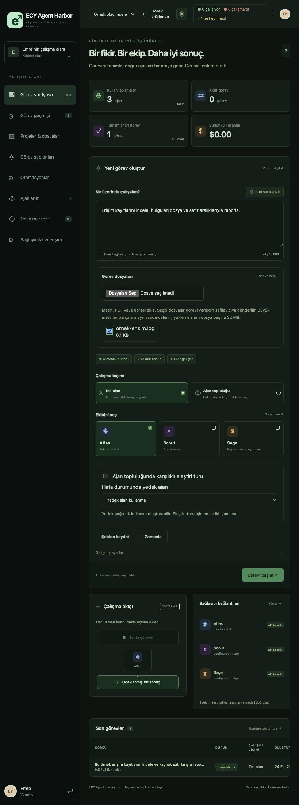

### English interface / İngilizce arayüz

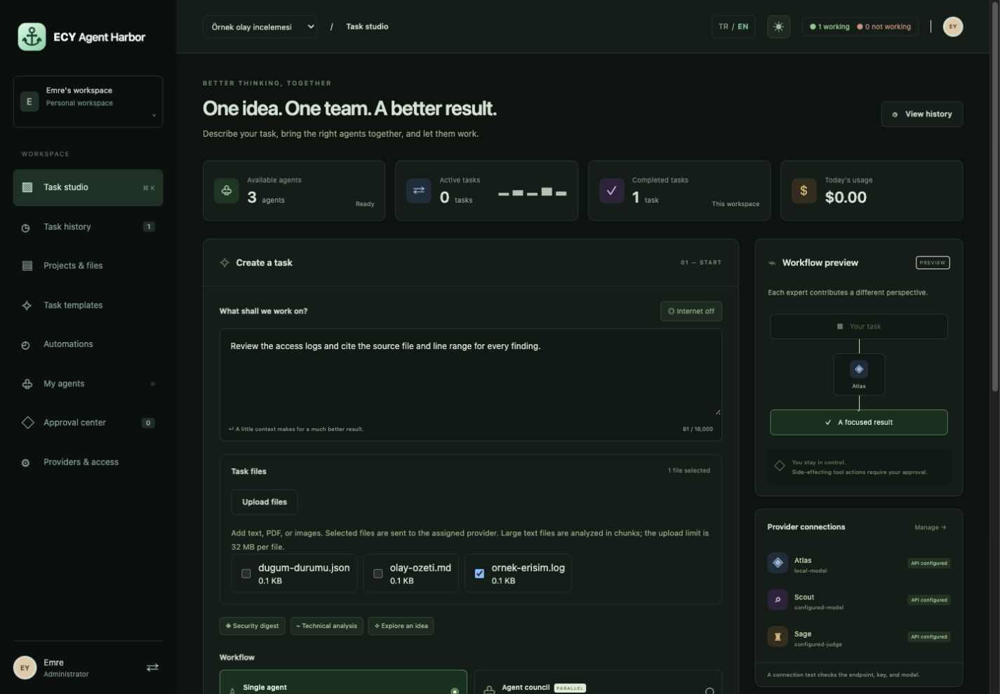

### Projects and evidence / Projeler ve kanıt dosyaları

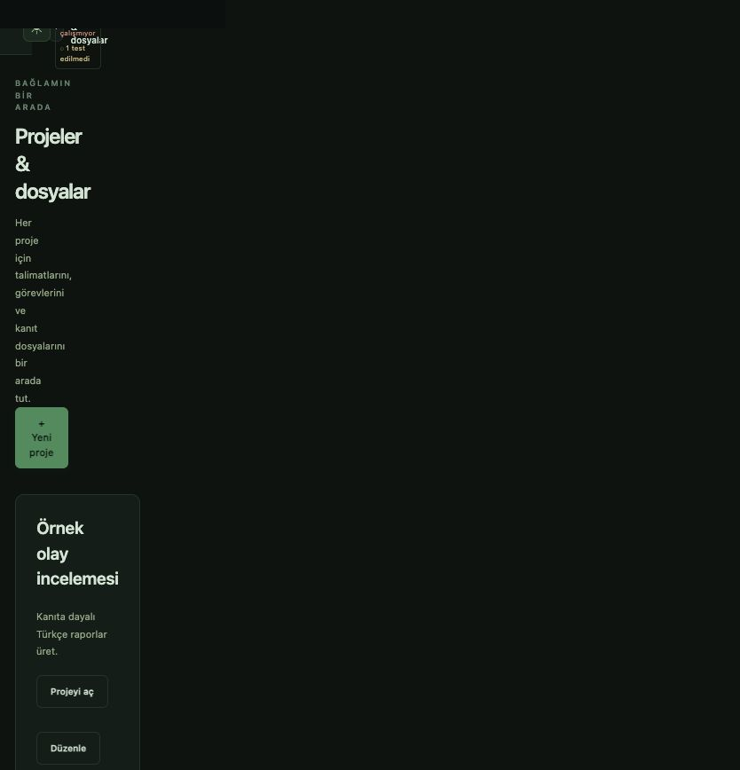

### Source-linked reports / Kaynaklı raporlar

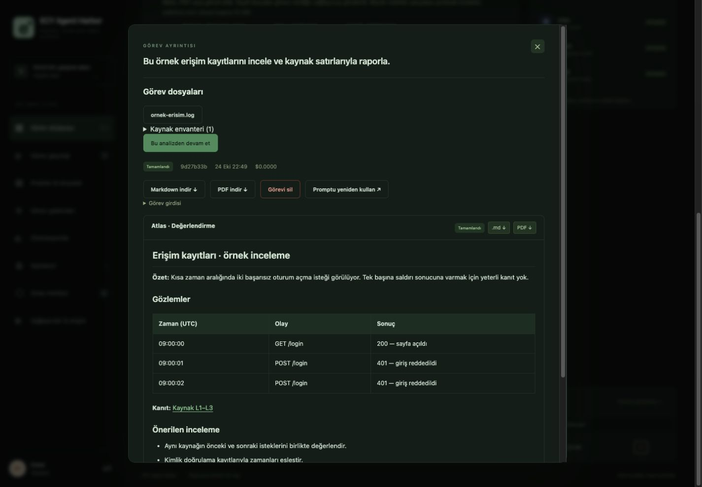

### Schedules and notifications / Zamanlama ve bildirimler

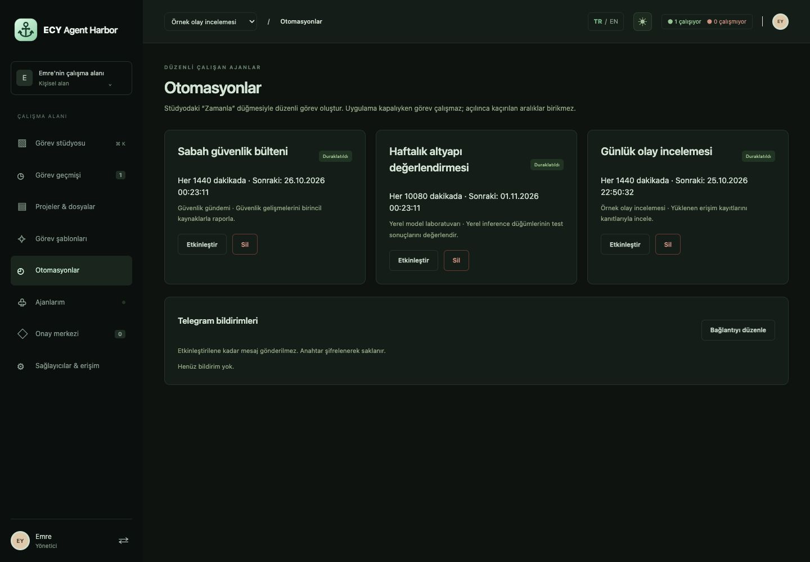

## Attribution / Atıf

When using, distributing, modifying, or hosting this software, retain the following visible credit in README documentation or an About/Credits section accessible to users. / Yazılımı kullanırken, değiştirirken, dağıtırken veya hizmet olarak sunarken README ya da kullanıcıların erişebileceği Hakkında / Credits bölümünde şu görünür atfı koru:

> ECY Agent Harbor — Emre Çağlar YILDIZ

See [LICENSE](LICENSE) for the exact conditions. This is a custom license based on MIT permissions with an additional visible-attribution requirement; it is not standard MIT. Third-party notices remain applicable. / Kesin koşullar [LICENSE](LICENSE) dosyasındadır. MIT izinlerine görünür atıf şartı ekleyen özel bir lisanstır; standart MIT değildir. Üçüncü taraf lisans bildirimleri korunur.

Saat dilimi / Time zone: **Europe/Istanbul (GMT+03:00)**. Görevler, loglar, raporlar ve günlük kullanım İstanbul saatine göre gösterilir. Tasks, logs, reports and daily usage follow Istanbul time. Stored timestamps remain UTC. Legacy deleted cost entries with only a UTC date retain their original date; lifetime totals remain exact.

### Yönetim / Management

Ayarlar tek menüde: Ajanlar & API, İnternet erişimi, Hesaplar & yetkiler, Bildirimler ve Kullanım. / Settings are grouped under one Management menu: Agents & API, Internet access, Accounts & permissions, Notifications, and Usage.

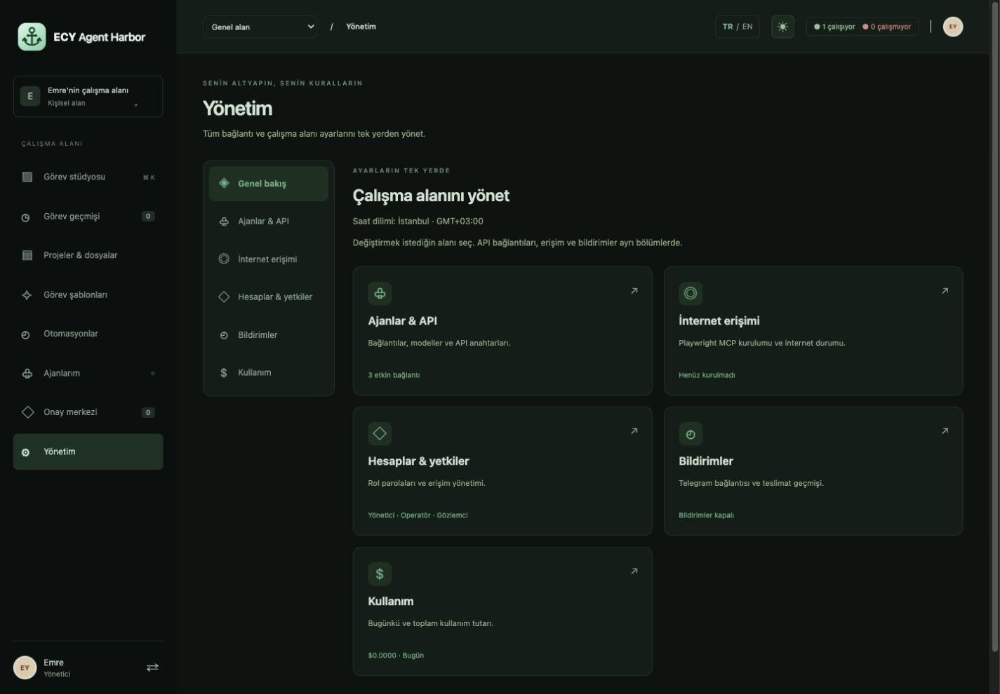

### Dosyalarda arama / Evidence search

**Projeler & dosyalar → Dosya içeriğinde ara**: Seçili projenin loglarında, metinlerinde ve çıkarılmış PDF metninde büyük/küçük harf duyarsız, düz metin araması. Eşleşmeler satır numarasıyla açılır; dosya göreve eklenebilir. Arama yereldir ve model çağrısı yapmaz. Görseller aranmaz.

**Projects & files → Search file contents**: Local, case-insensitive literal search across the selected project's text, logs and extracted PDF text. Open matching source lines or attach a file to the task. Images are excluded; no model call is made. Results are paginated, with one result per matching line. Search is a direct scan, not a semantic index.

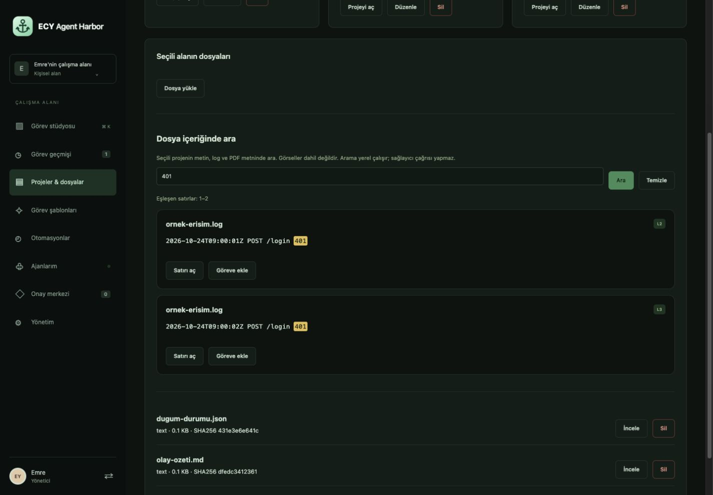

## Investigation platform / İnceleme platformu

Task conversations · Report comparison · Audited findings/actions · Live activity · Project knowledge bank · Declared agent capabilities · Encrypted portable backup/restore · Scoped idempotent webhooks.

Görev sohbeti · Rapor karşılaştırma · Geçmişli bulgu/aksiyon takibi · Canlı akış · Proje bilgi bankası · Ajan yetenekleri · Şifreli taşınabilir yedek/geri yükleme · Yetkili ve tekrar korumalı webhook bağlantıları.

[Platform guide / Platform kılavuzu](docs/PLATFORM.md) · [Eight-phase plan / Sekiz faz planı](docs/ROADMAP-PLATFORM.md)

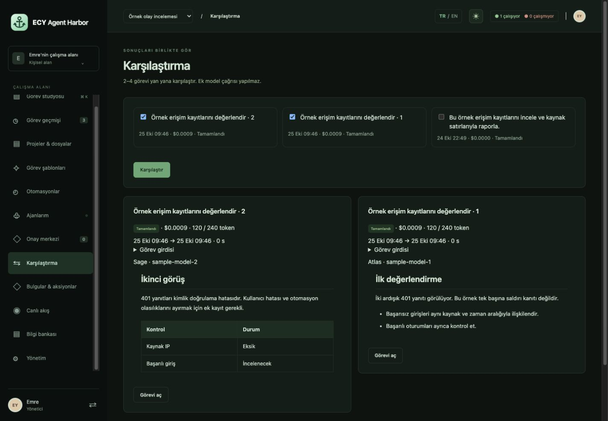

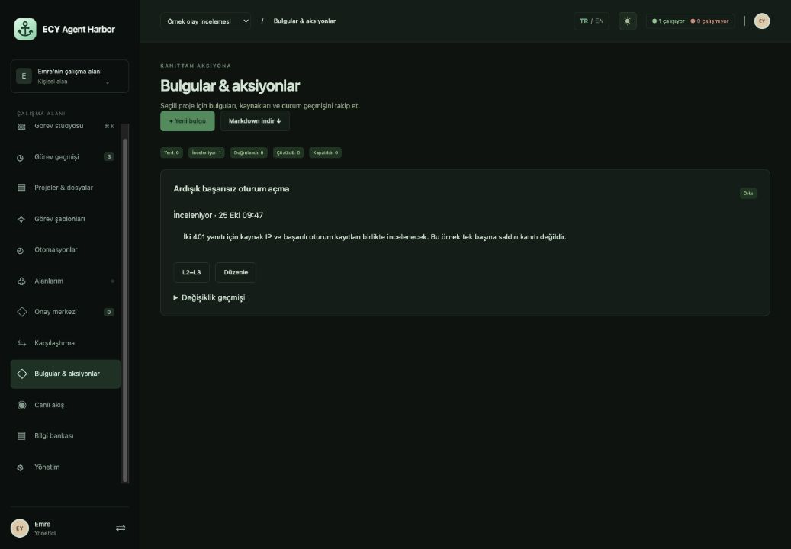

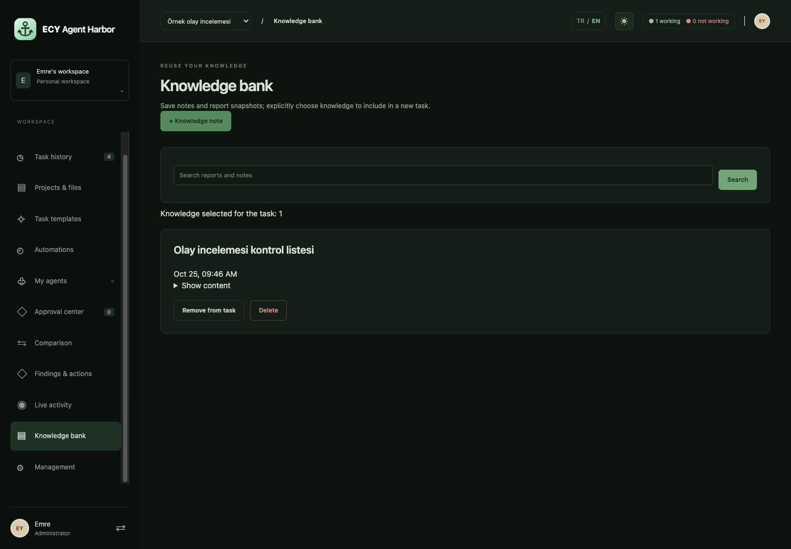

## MCP & security / MCP ve güvenlik

[Tool center / Araç merkezi](docs/MCP.md) · [Secure deployment / Güvenli yayın](docs/SECURITY-DEPLOYMENT.md) · [Next phases / Sonraki fazlar](docs/NEXT-PHASES.md) · [Security policy](SECURITY.md)

First setup now requires the local terminal bootstrap code. Enroll MFA in Management → Security before public deployment. / İlk kurulum artık yerel terminal kodunu gerektirir. Dış erişim öncesi Yönetim → Güvenlik üzerinden MFA kur.

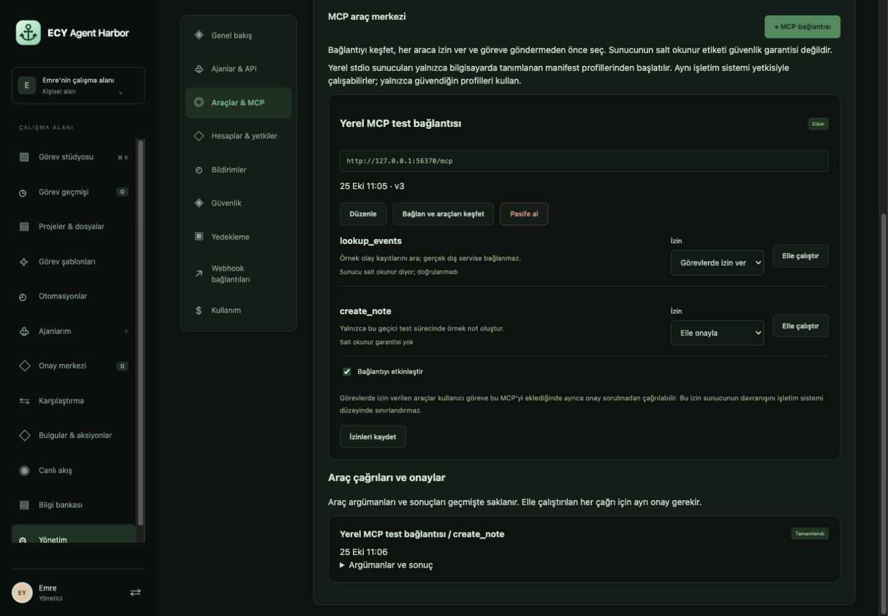

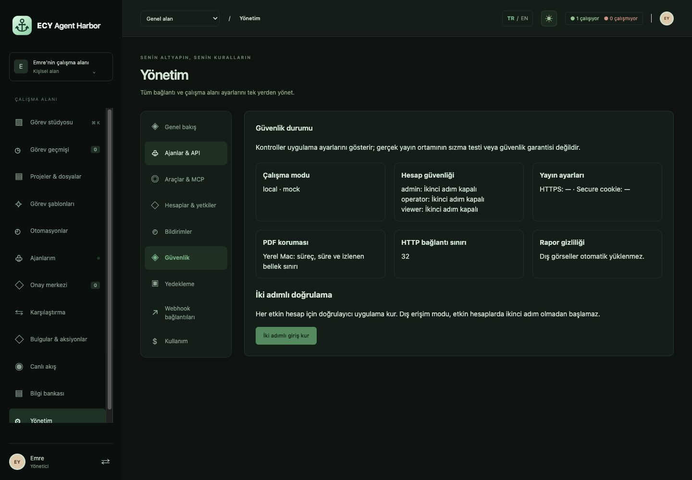

## Task playbooks / Görev reçeteleri

Build reusable multi-step tasks, review each step before dispatch, pause/cancel safely and retain attempts. / Tekrarlanabilir işleri adımlara böl, her adımı inceleyip başlat, duraklat/iptal et ve deneme geçmişini koru. [Guide / Kılavuz](docs/PLAYBOOKS.md).

## Incident desk / Olay masası

Local log grouping with exact source lines, human confidence assessments and approved action tracking. No automatic external remediation. / Yerel log gruplama, kaynak satırları, insan güven değerlendirmesi ve onaylı aksiyon takibi. [Guide / Kılavuz](docs/INCIDENT-DESK.md).

## Context, model lab & operations / Bağlam, model laboratuvarı ve operasyon

Local source preview and opt-in text masking; explicit comparable model trials with human ratings and optional judge; scoped node heartbeats and provider circuit breakers. / Yerel kaynak önizlemesi ve metin maskeleme; insan puanlı, seçilebilir baş uzmanlı model denemeleri; sınırlı düğüm sağlık sinyalleri ve sağlayıcı devre kesicileri. [Guide / Kılavuz](docs/PRIVACY-LAB-OPERATIONS.md).

## New workflow screens / Yeni akış ekranları

Isolated mock workspace with fictional data and example ratings; no real hardware/model benchmark is claimed. / Kurgu verili izole test alanı; örnek puanlar gerçek model veya donanım ölçümü değildir.

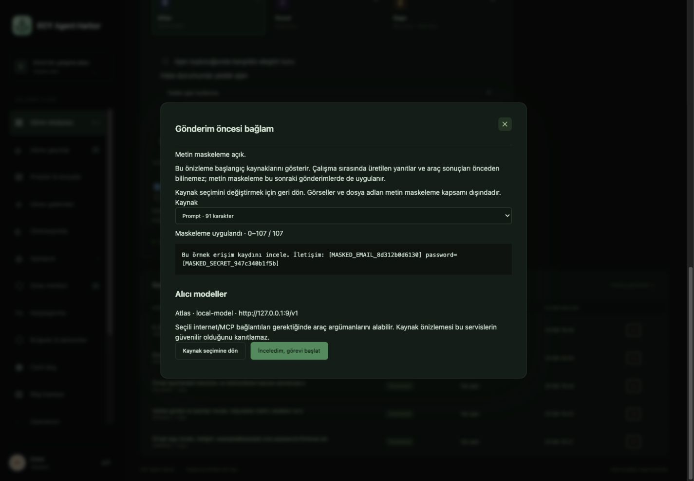

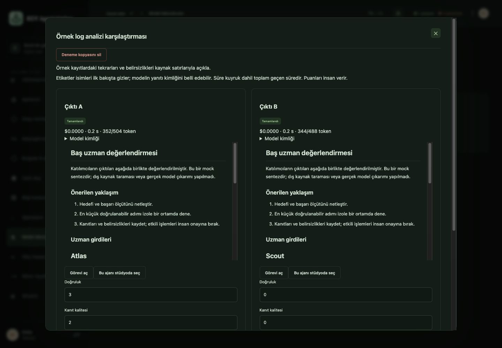

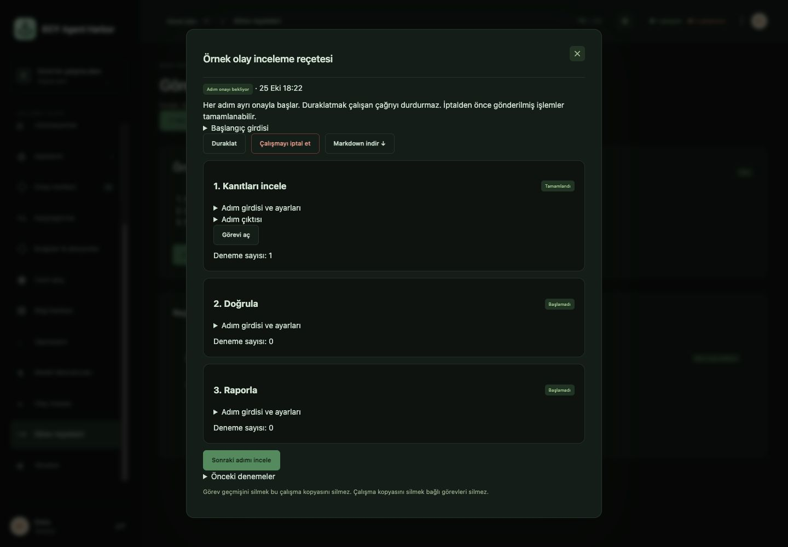

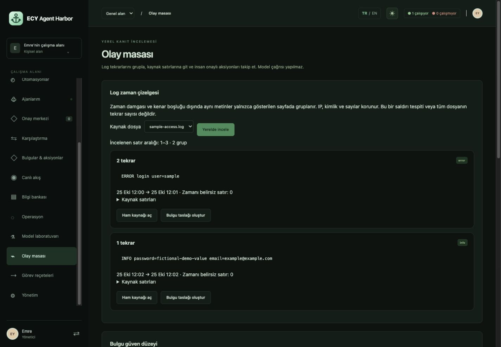

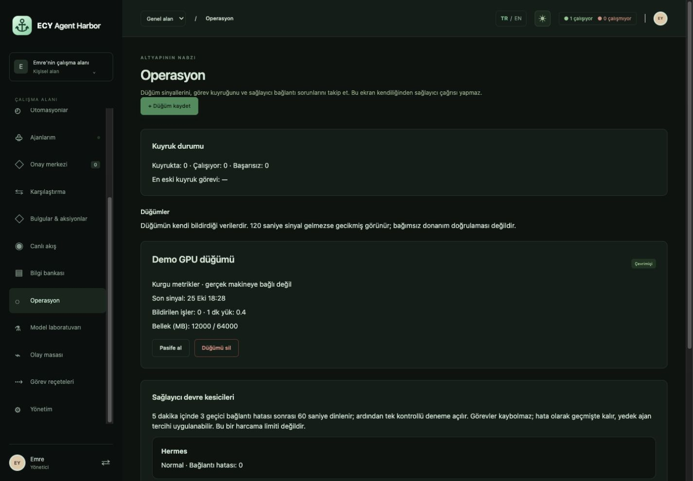
