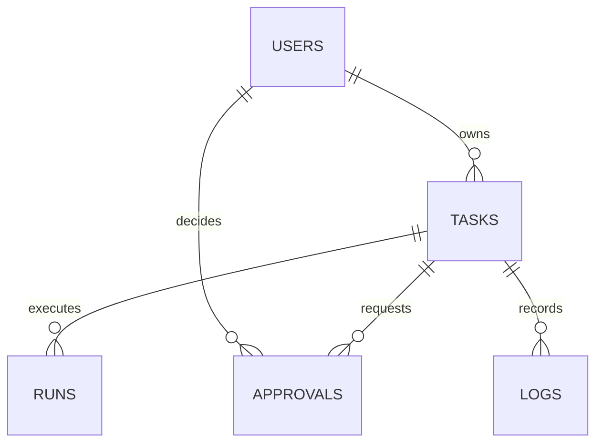

# Veri modeli ve yürütme tasarımı

## Tablolar

| Tablo | Anahtar / ilişkiler | Temel alanlar |
|---|---|---|
| users | id PK | name, role |
| credentials | user_id PK → users | salt, password_hash |
| agent_configs | id PK | config JSON (encrypted_key dahil), updated_at; deleted işareti ile erişimsiz geçmiş etiketi |
| deleted_costs | id PK | day, amount; içerik veya task kimliği bulunmaz |
| tasks | id PK; owner_id → users | prompt, title, mode, agents JSON, judge, status, budget, reserved, cost, tool_requested, synthesis, error, created_at, updated_at |
| runs | id PK; task_id → tasks | agent_id, kind, status, output, input_tokens, output_tokens, cost, error, created_at |
| approvals | id PK; task_id → tasks; decided_by → users | tool, arguments JSON, status, created_at, decided_at |
| logs | id integer PK; task_id → tasks | event, message, created_at |

Ajan profilleri agent_configs tablosunda kalıcı tutulur; AGENTS/BY_ID çalışma zamanı önbelleğidir. Ayarlar yönetici API üzerinden değiştirilir. Anahtarlar Fernet ile şifrelenir; master key ayrı data/master.key dosyasındadır. Fiyatlar örnektir, donanım tanımları bağlantı durumunun kanıtı değildir. `configured` yalnızca endpoint tanımlandığını belirtir; gerçek sağlık testi değildir.

## Eşzamanlılık

SQLite WAL + foreign key kontrolleri etkin. Görev alma, bütçe rezervasyonu, iptal ve onay kararları `BEGIN IMMEDIATE` içinde seri hale getirilir. Her işçi bir görevi, kendi ThreadPoolExecutor'ı ile en çok dört katılımcıyı çalıştırır. İki işçi ile en çok sekiz model çağrısı paralel olabilir. Baş uzman, katılımcılar tamamlandıktan sonra ayrı run olarak çalışır.

Tek uygulama instance'ı hedeflenir. Başlangıç kurtarması `running` görevleri başarısız işaretlediğinden aynı veritabanına birden fazla uygulama instance'ı bağlanmamalı. Çok instance senaryosunda lease/heartbeat ve distributed scheduler gerekir.

## Araç sınırı

Prompt ve model çıktısı komut değildir. Sağlayıcı çağrılarına `tools` yeteneği verilmez. Yalnızca kullanıcının görev formunda işaretlediği dosya kaydı isteği onaya dönüşür. Approval kaydı, görev kimliği, sabit araç adı ve sunucunun belirlediği argümanlarla bağlıdır. Admin kararı ve mevcut pending durumu transaction içinde kontrol edilir. Dosya adı task UUID'den türetilir; kullanıcı veya model dosya yolu belirleyemez.

Dosya yazma deterministiktir: aynı task kimliği aynı dosyaya gider. İşlem sırasında çöküş olursa aynı içeriği yeniden yazma güvenlidir; genel anlamda harici sistemler için exactly-once garantisi sunulmaz. Uzak araçlar ayrı idempotency anahtarı ve executor gerektirir.

## Erişim

Tüm kullanıcılar ortak çalışma alanını okur. Viewer yazamaz; operator görev oluşturur ve kendininkini iptal eder; admin tüm görevleri iptal eder ve araç kararlarını verir. Tokenlar sadece login kontrolünde kullanılır; 8 saatlik rastgele HttpOnly + SameSite=Strict oturum çerezi oluşturulur. POST için oturuma bağlı CSRF tokenı gerekir. Normal açılış live moddur. İlk kurulum admin parolası belirler; parolalar PBKDF2-SHA256 ile hashlenir. Yönetici diğer rollerin parolalarını ayarlardan belirler. Eski AUTH_*_TOKEN ortam ayarları uyumluluk için ayrıca desteklenir.

## Sonraki sürüm sınırları

1. OIDC kullanıcıları ve workspace üyelikleri, çok kiracılı veri izolasyonu.
2. PostgreSQL + kuyruk servisinde lease, retry ve idempotent provider çağrı kayıtları.
3. Sağlayıcıya/model sürümüne göre ayrı input/output tarifeleri ve kota yönetimi.
4. Streaming çıktı, gerçek sağlayıcı sağlık testi, context window yönetimi ve maliyet mutabakatı.
5. İnsan tarafından onaylanan, kısıtlı uzak tool executor ve yalnızca gerekli Hermes bridge yetkileri.

## Rapor indirme

Export endpoint görev ve run sahipliğini ilişki üzerinden doğrular, ortak çalışma alanının okuma yetkisine uyar. Markdown sunucuda UTF-8 üretilir. PDF ReportLab ve paket içindeki Vera fontlarıyla oluşturulur; metin HTML olarak escape edilir. İndirme ayrı side effect executor çalıştırmaz.

## Silme ve bütçe

Görev silme aynı transaction içinde bağımlı run/log/approval kayıtlarını temizler ve maliyeti deleted_costs tablosuna aktarır. Böylece geçmiş temizliği günlük limiti yeniden açamaz. Görev statusu, reserved alanı ve devam eden run kayıtları birlikte kontrol edilir. Ajan silme; endpoint/anahtar/talimatı temizleyen bir tombstone tutar. Görev çıktılarını ve ajan adını geçmiş için korur; başlangıç kaydı yeniden başlatmada dirilmez.

Yanıt bitişi: runs.finish_reason alanı sağlayıcının bitiş gerekçesini taşır. runs.output_limit yalnızca eski kayıtların hangi sınırla üretildiğini göstermek içindir; yeni normal görevlerde NULL olur. tasks.continuation_context, devam görevinde önceki cevabın tamamını saklar; genel state yanıtına tekrar eklenmez. Katılımcı çıktıları judge girdisinde kırpılmaz.

## Tarayıcı MCP sınırı

web_enabled görev bazlı kalıcı bayraktır. Varsayılan kapalıdır. Açıkken her ajan için ayrı BrowserMCP oturumu oluşturulur. MCP stdio istemcisi tools/call üzerinden yalnızca browser_navigate çağırır; MCP sunucusunun diğer araçları modele ilan edilmez. Modelde iki dar function tool bulunur: web_search/web_open. PublicProxy doğrudan doğrulanmış genel IP'ye bağlanır ve HTTPS CONNECT tünelini geçirir. browser_guard.cjs yöntem ve WebSocket filtrelerini uygular. BrowserMCP kapanışı tarayıcı alt sürecini, yerel proxy'yi ve geçici profili temizler. Docker tarayıcı sandbox çalışması bu ortamda test edilmedi; güvenliği azaltan --no-sandbox kullanılmaz.

Son sürümde günlük/görev harcama kotası kaldırılmıştır; usage toplamları sadece izlenir. Private runs.provider_state tur ve kaynak geçmişini tutar. tasks.resume_state, yeni rapor finalleştirme işine bu geçmişi taşır. Public API bunları temizler. Boş completed kayıtları başlangıçta incomplete olarak düzeltilir, mevcut maliyetler korunur.

## Çalışma alanı genişletmeleri

`workspace.py` eklemeli şema geçişlerini, sahiplik denetimlerini ve proje/şablon/zamanlama API'sini sağlar. `files.py` opaque dosya kimlikleriyle 0600 izinli ham dosyaları, metadata ve metin çıkarımını tutar. Görevler `task_files` ile kanıta bağlanır; görev silinmesi bağlantıyı cascade eder, kanıt dosyasını otomatik silmez.

`streaming.py` SSE content/reasoning/tool-call parçalarını ayırır. Yalnızca görünür content `_on_delta` ile yaklaşık 300 ms'de SQLite'a yazılır. UI iki saniyelik mevcut polling ile görünür metni alır. Sağlayıcı akışı finish_reason olmadan biterse incomplete olur. 400 ile reddedilen akış isteği bir kez normal JSON sözleşmesiyle gönderilir. Geçici bağlantı/429/5xx hatasında hiçbir parça veya tool sonucu alınmamışsa bir tekrar yapılır; kısmi çalışma otomatik oynatılmaz.

`pipeline.py` dosyaların tüm metin parçalarını işler; uzun tek satırlar da kaybolmadan bölünür. Ara adımlar ayrı run kayıtlarıdır. Kaynak atıfları özetleme boyunca istenir ve korunur; modelin anlamsal özet kalitesi otomatik garanti edilmez. Dosyasız eski akışlarda baş uzmana tam katılımcı yanıtı aktarılmaya devam edilir. Karşılıklı eleştiri ve baş uzman seçimi görev seçenekleridir; yedek ajan her geçişi ayrı run/log kaydıyla görünür kılar.

`automation.py` aynı CONFIG_LOCK ve SQLite yazma işlemini kullanarak zamanlama/task kaydını atomik bağlar; açık görevler çakışmaz. Telegram tokenı vault ile şifrelenir. Gönderim sabit `api.telegram.org` uç noktasına, redirect olmadan yapılır; outbox belirsiz teslimatları tekrar etmez. Tek bir `notified` işareti görevin ilk terminal/onay durumunu bildirmek içindir. Her aralığın tam dakikasında çalışacağı veya harici Telegram'da exactly-once teslimat garantisi verilmez.
